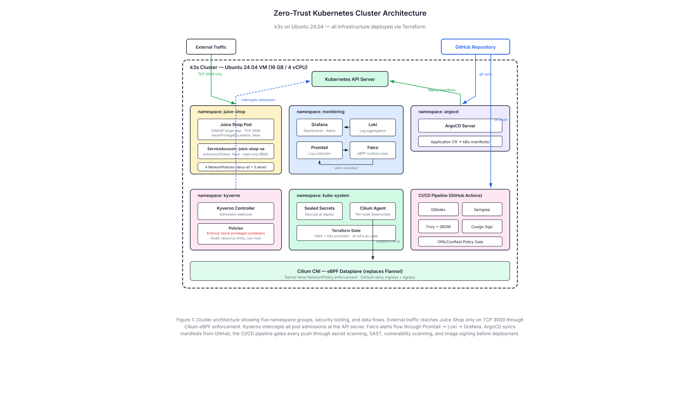
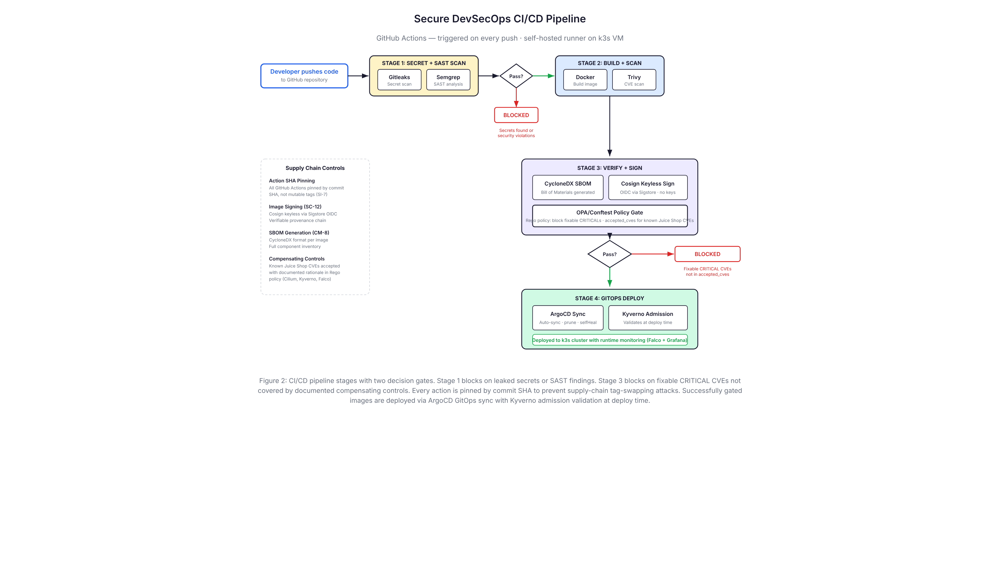
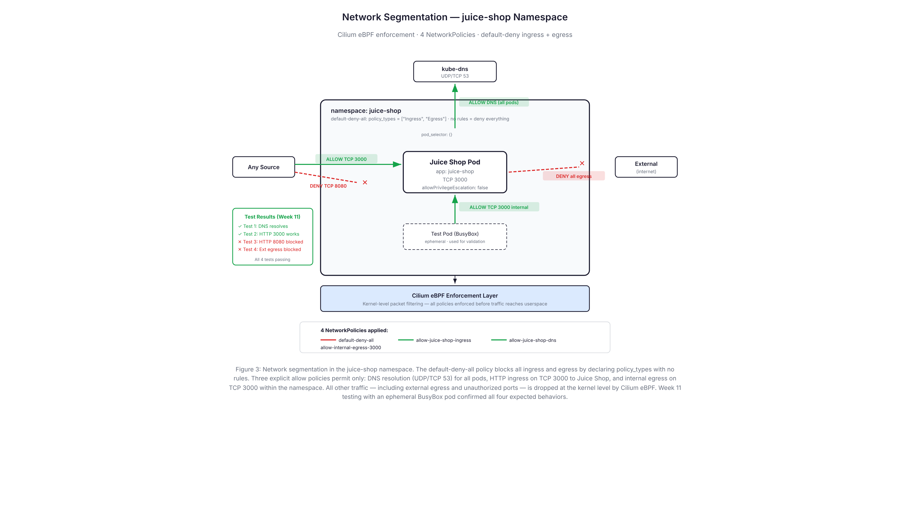
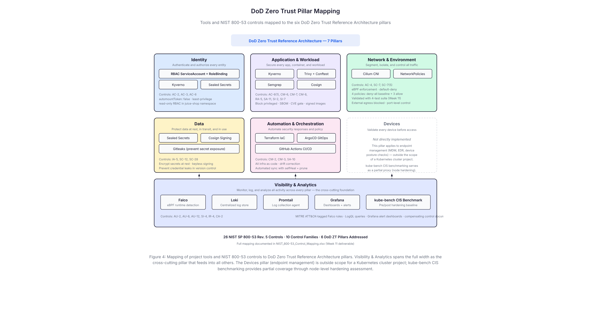

# Zero-Trust Kubernetes Cluster Hardening with Secure DevSecOps CI/CD Pipeline

A 16-week senior capstone project implementing a Zero Trust security architecture on a Kubernetes cluster with an integrated DevSecOps CI/CD pipeline. The project maps 26 NIST SP 800-53 Rev. 5 controls across 10 control families and aligns with all six pillars of the DoD Zero Trust Reference Architecture.

**Target application:** [OWASP Juice Shop](https://owasp.org/www-project-juice-shop/) — an intentionally vulnerable web application used as the workload to secure, scan, and monitor.

**Infrastructure approach:** All cluster hardening and security tooling is deployed as Infrastructure as Code using Terraform (Helm + Kubernetes providers), with GitOps continuous delivery via ArgoCD.

---

## Architecture

### Cluster Overview



The cluster runs on k3s (lightweight Kubernetes) on an Ubuntu 24.04 VM. Security tooling spans five namespace groups:

- **juice-shop** — Target application with dedicated ServiceAccount, RBAC least-privilege bindings, and four NetworkPolicies enforcing default-deny with explicit allow rules
- **monitoring** — Falco (eBPF runtime detection), Loki (log aggregation), Promtail (log collection), and Grafana (dashboards and alerting)
- **argocd** — GitOps controller syncing Kubernetes manifests from this repository with automated self-healing and pruning
- **kyverno** — Admission controller intercepting all pod creation requests at the API server to enforce security policies
- **kube-system** — Cilium CNI (eBPF-based network enforcement), Sealed Secrets controller, and Terraform state

### CI/CD Pipeline



Every push to this repository triggers a four-stage GitHub Actions pipeline on a self-hosted runner:

| Stage | Tools | What It Does |
|-------|-------|-------------|
| **1. Secret + SAST Scan** | Gitleaks, Semgrep | Scans for leaked secrets and static application security vulnerabilities. Blocks the pipeline on any finding. |
| **2. Build + Scan** | Docker, Trivy | Builds the container image and scans it for known CVEs. Found 50 CVEs (8 critical) in the Juice Shop base image. |
| **3. Verify + Sign** | CycloneDX SBOM, Cosign, OPA/Conftest | Generates a Software Bill of Materials, cryptographically signs the image via Sigstore keyless signing, and evaluates a Rego policy gate that blocks deployment of images with fixable CRITICAL CVEs. |
| **4. GitOps Deploy** | ArgoCD, Kyverno | ArgoCD syncs the signed, scanned image to the cluster. Kyverno validates the deployment at admission time, blocking privileged containers and enforcing security context constraints. |

All GitHub Actions are pinned by commit SHA (not mutable tags) to prevent supply-chain tag-swapping attacks — a practice flagged and enforced by Semgrep SAST scanning.

### Network Segmentation



The juice-shop namespace enforces microsegmentation through four Kubernetes NetworkPolicies with Cilium eBPF enforcement:

1. **default-deny-all** — Blocks all ingress and egress by declaring `policy_types: ["Ingress", "Egress"]` with no rules
2. **allow-juice-shop-ingress** — Permits TCP 3000 inbound to Juice Shop pods only
3. **allow-juice-shop-dns** — Permits UDP/TCP 53 outbound for DNS resolution (all pods)
4. **allow-internal-egress-3000** — Permits TCP 3000 egress within the namespace only

All other traffic — including external egress and unauthorized ports — is dropped at the kernel level before reaching userspace. This was validated with a four-test suite using an ephemeral BusyBox pod (see [Testing](#testing)).

### DoD Zero Trust Alignment



| DoD ZT Pillar | Tools | Key Controls |
|---------------|-------|-------------|
| **Identity** | RBAC, ServiceAccount, Kyverno, Sealed Secrets | AC-2, AC-3, AC-6 |
| **Application & Workload** | Kyverno, Trivy, Conftest, Semgrep, Cosign | AC-6(1), CM-6, CM-7, CM-8, RA-5, SA-11, SI-2, SI-7 |
| **Network & Environment** | Cilium CNI, NetworkPolicies | AC-4, SC-7, SC-7(5) |
| **Data** | Sealed Secrets, Cosign, Gitleaks | IA-5, SC-12, SC-28 |
| **Automation & Orchestration** | Terraform, ArgoCD, GitHub Actions | CM-2, CM-3, SA-10 |
| **Visibility & Analytics** | Falco, Loki, Promtail, Grafana, kube-bench | AU-2, AU-6, AU-12, SI-4, IR-4, CA-2 |

The Devices pillar (endpoint management, MDM/EDR) is outside the scope of a Kubernetes cluster project. kube-bench CIS benchmarking provides partial coverage through node-level hardening assessment.

Full control mapping: [`docs/NIST_800-53_Control_Mapping.xlsx`](docs/NIST_800-53_Control_Mapping.xlsx)

---

## Repository Structure

```
├── .github/
│   └── workflows/           # GitHub Actions CI/CD pipeline definitions
├── docs/
│   ├── diagrams/            # Architecture diagrams (PNG)
│   └── NIST_800-53_Control_Mapping.xlsx  # 26-control compliance mapping
├── infra/                   # Terraform Infrastructure as Code
│   ├── providers.tf         # Helm, Kubernetes, kubectl provider config
│   ├── cilium.tf            # Cilium CNI (replaces Flannel)
│   ├── network-policies.tf  # 4 NetworkPolicies (default-deny + allows)
│   ├── rbac.tf              # ServiceAccount + Role + RoleBinding
│   ├── juice-shop.tf        # Target application deployment
│   ├── kyverno.tf           # Kyverno admission controller
│   ├── kyverno-policies.tf  # ClusterPolicies (privileged, resources, non-root)
│   ├── sealed-secrets.tf    # Sealed Secrets controller
│   ├── falco.tf             # Falco runtime security (eBPF)
│   ├── monitoring.tf        # Loki + Promtail + Grafana stack
│   └── argocd.tf            # ArgoCD + Application CR
├── k8s-manifests/           # Kubernetes manifests (synced by ArgoCD)
│   └── juice-shop.yaml      # Deployment + Service with security context
├── policies/
│   ├── trivy-policy.rego    # OPA/Conftest CVE gate with compensating controls
│   └── ...
└── README.md
```

---

## Security Tools

| Tool | Purpose | DoD ZT Pillar |
|------|---------|---------------|
| **Cilium** | eBPF-based CNI replacing Flannel. Enforces NetworkPolicies at the kernel level. | Network & Environment |
| **Kyverno** | Admission controller blocking privileged containers (Enforce) and auditing resource limits and non-root (Audit). | Application & Workload |
| **Falco** | Runtime threat detection via eBPF kernel probes. Custom rules tagged with MITRE ATT&CK techniques (T1003, T1059, T1496). | Visibility & Analytics |
| **Trivy** | Container image vulnerability scanner. Identifies CVEs by severity with Conftest policy gate. | Application & Workload |
| **Semgrep** | Static application security testing (SAST). Caught mutable GitHub Actions tags as a supply-chain risk. | Application & Workload |
| **Gitleaks** | Pre-commit secret scanning. Prevents API keys, credentials, and tokens from entering version control. | Data |
| **Cosign** | Keyless container image signing via Sigstore OIDC. Establishes cryptographic provenance chain. | Data |
| **CycloneDX** | Software Bill of Materials (SBOM) generation in CycloneDX format for every container image built. | Application & Workload |
| **OPA/Conftest** | Rego policy engine evaluating Trivy scan results. Blocks fixable CRITICALs; accepts known Juice Shop CVEs with documented compensating controls. | Application & Workload |
| **Sealed Secrets** | Encrypts Kubernetes Secrets with asymmetric encryption so they can be safely stored in Git. | Data |
| **ArgoCD** | GitOps continuous delivery. Auto-syncs k8s-manifests/ with selfHeal and prune enabled. | Automation & Orchestration |
| **Grafana + Loki + Promtail** | Centralized logging and visualization. Falco alerts flow through Promtail → Loki → Grafana dashboards. | Visibility & Analytics |
| **kube-bench** | CIS Kubernetes Benchmark v1.8 scanner. Pre-hardening: 9 PASS, 12 FAIL. Post-hardening: 1 PASS, 17 FAIL (k3s architectural differences documented as compensating controls). | Visibility & Analytics |
| **Terraform** | Infrastructure as Code. All cluster security tooling defined in `infra/` directory with Helm + Kubernetes providers. | Automation & Orchestration |

---

## Testing

### NetworkPolicy Validation (Week 11)

A four-test suite was run using an ephemeral BusyBox pod inside the juice-shop namespace to validate that the NetworkPolicies enforce the expected behavior:

```bash
kubectl run test-netpol --rm -it --restart=Never \
  --image=busybox -n juice-shop -- sh
```

| Test | Command | Expected | Result |
|------|---------|----------|--------|
| 1. DNS resolution | `nslookup juice-shop.juice-shop.svc.cluster.local` | Resolves | ✅ Pass |
| 2. HTTP port 3000 | `wget -qO- --timeout=5 http://juice-shop.juice-shop.svc.cluster.local:3000` | Returns HTML | ✅ Pass |
| 3. HTTP port 8080 | `wget -qO- --timeout=5 http://juice-shop.juice-shop.svc.cluster.local:8080` | Timeout | ✅ Pass (blocked) |
| 4. External egress | `wget -qO- --timeout=5 http://1.1.1.1` | Timeout | ✅ Pass (blocked) |

This testing discovered and fixed two bugs in the original NetworkPolicy configuration:
- The default-deny policy had empty `ingress {}` / `egress {}` blocks, which in Kubernetes NetworkPolicy semantics means "allow all" — the opposite of the intended default-deny
- The ingress allow policy declared `policy_types: ["Ingress"]` but had no `ingress` block with port rules, making it a deny-all instead of an allow on port 3000

### CIS Benchmark (kube-bench)

| Metric | Pre-Hardening | Post-Hardening |
|--------|--------------|----------------|
| PASS | 9 | 1 |
| FAIL | 12 | 17 |
| WARN | 33 | 41 |
| INFO | 5 | 1 |

**Why the post-hardening numbers look worse:** kube-bench is built for `kubeadm`-based clusters, where each Kubernetes component (API server, scheduler, controller-manager, etcd) runs as a separate binary with its own config file in `/etc/kubernetes/manifests/`. k3s bundles all of these into a single binary with an embedded datastore — there are no separate component config files for kube-bench to inspect. When kube-bench looks for files that don't exist in k3s's architecture, it marks each check as FAIL.

The post-hardening scan ran more comprehensive test sections than the initial baseline, which exposed more of these architectural mismatches. The failures are not security regressions — they are false positives caused by k3s's single-binary architecture not matching kube-bench's kubeadm assumptions. Each mismatch is documented as a compensating control explaining why the check does not apply to k3s and what equivalent protection exists (e.g., k3s's embedded etcd is only accessible via the k3s binary itself, so the separate etcd TLS checks are not applicable).

### CI/CD Pipeline

The pipeline runs on every push via a self-hosted GitHub Actions runner on the k3s VM. Current status: all stages passing, including Gitleaks secret scan, Semgrep SAST, Trivy vulnerability scan, SBOM generation, Cosign image signing, and Conftest policy gate.

---

## Prerequisites

| Requirement | Version Used |
|-------------|-------------|
| Ubuntu | 24.04 LTS |
| VirtualBox (or equivalent) | Host with 16 GB RAM, 4 vCPUs, 80 GB disk |
| k3s | Latest stable |
| Terraform | >= 1.5 |
| Helm | >= 3.x |
| kubectl | Matches k3s version |
| GitHub account | For Actions CI/CD and self-hosted runner |

## Reproduction Steps

### 1. Provision the VM

Create an Ubuntu 24.04 VM with at least 16 GB RAM, 4 vCPUs, and 80 GB disk. Configure network access (NAT with port forwarding for SSH on port 2222 if using VirtualBox).

### 2. Install k3s

```bash
curl -sfL https://get.k3s.io | INSTALL_K3S_EXEC="--flannel-backend=none --disable-network-policy" sh -
```

Flannel is disabled because Cilium replaces it as the CNI with eBPF-based networking and policy enforcement.

### 3. Deploy Infrastructure with Terraform

```bash
cd infra/
terraform init
terraform apply
```

This deploys all security tooling in dependency order: Cilium → NetworkPolicies → RBAC → Juice Shop → Kyverno + policies → Sealed Secrets → Falco → Loki/Promtail/Grafana → ArgoCD.

### 4. Set Up the CI/CD Pipeline

1. Fork this repository
2. Configure a [self-hosted GitHub Actions runner](https://docs.github.com/en/actions/hosting-your-own-runners) on the VM
3. Push a commit to trigger the pipeline

### 5. Validate

```bash
# Check all pods are running
kubectl get pods -A

# Run NetworkPolicy tests
kubectl run test-netpol --rm -it --restart=Never \
  --image=busybox -n juice-shop -- sh

# View Grafana dashboards (Falco alerts, log queries)
# Access via NodePort or port-forward

# Check ArgoCD sync status
kubectl get applications -n argocd
```

---

## NIST SP 800-53 Compliance

This project maps to 26 controls across 10 NIST SP 800-53 Rev. 5 control families:

| Family | Controls | Count |
|--------|----------|-------|
| Access Control (AC) | AC-2, AC-3, AC-4, AC-6, AC-6(1) | 5 |
| Audit & Accountability (AU) | AU-2, AU-6, AU-12 | 3 |
| Configuration Management (CM) | CM-2, CM-3, CM-6, CM-7, CM-8 | 5 |
| Identification & Authentication (IA) | IA-5 | 1 |
| Incident Response (IR) | IR-4 | 1 |
| Risk Assessment (RA) | RA-5 | 1 |
| Security Assessment (CA) | CA-2 | 1 |
| System & Communications Protection (SC) | SC-7, SC-7(5), SC-12, SC-28 | 4 |
| System & Information Integrity (SI) | SI-2, SI-4, SI-7 | 3 |
| System & Services Acquisition (SA) | SA-10, SA-11 | 2 |
| **Total** | | **26** |

Full mapping with implementation details, evidence artifacts, and DoD ZT pillar alignment: [`docs/NIST_800-53_Control_Mapping.xlsx`](docs/NIST_800-53_Control_Mapping.xlsx)

---

## Project Timeline

| Week | Milestone |
|------|-----------|
| 1–2 | k3s cluster setup, Juice Shop deployment, kube-bench CIS baseline |
| 3–4 | CI/CD pipeline: Semgrep SAST, Gitleaks secrets, Trivy CVE scanning, CycloneDX SBOM |
| 5 | Cosign keyless image signing, OPA/Conftest policy gate |
| 6 | Cilium CNI (eBPF), Terraform IaC migration, default-deny NetworkPolicies |
| 7 | RBAC least-privilege: dedicated ServiceAccount, RoleBinding, token disabled |
| 8 | Kyverno admission controller, Sealed Secrets |
| 9 | Falco runtime detection (MITRE ATT&CK rules), Loki + Promtail + Grafana, post-hardening CIS scan |
| 10 | ArgoCD GitOps deployment with auto-sync, selfHeal, and pruning |
| 11 | NetworkPolicy testing and bug fixes, NIST SP 800-53 control mapping |
| 12 | Architecture diagrams |
| 13 | README and documentation polish |
| 14 | Demo video and presentation |
| 15 | Research paper (3,000 words, 15 academic/government sources) |
| 16 | Final polish and submission |

---

## References

- [NIST SP 800-207: Zero Trust Architecture](https://csrc.nist.gov/publications/detail/sp/800-207/final)
- [NIST SP 800-53 Rev. 5: Security and Privacy Controls](https://csrc.nist.gov/publications/detail/sp/800-53/rev-5/final)
- [DoD Zero Trust Reference Architecture](https://dodcio.defense.gov/Portals/0/Documents/Library/DoD-ZTRef-Arch.pdf)
- [CIS Kubernetes Benchmark](https://www.cisecurity.org/benchmark/kubernetes)
- [CISA Zero Trust Maturity Model](https://www.cisa.gov/zero-trust-maturity-model)

---

## Author

**Connor Wade**

Built as a senior capstone project combining cybersecurity and computer science, targeting Department of Defense and Department of Homeland Security cybersecurity engineering positions.

## License

This project is provided for educational and portfolio purposes.
